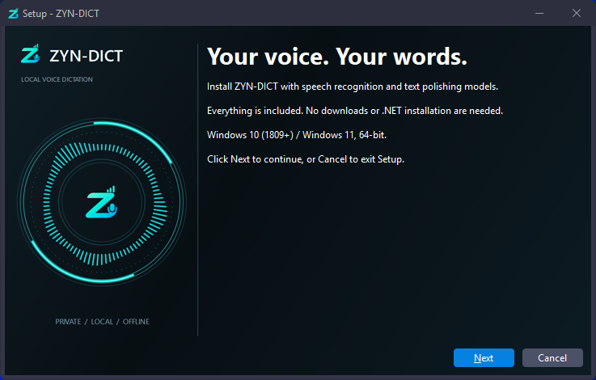
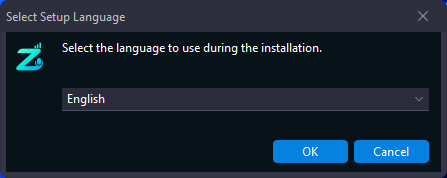
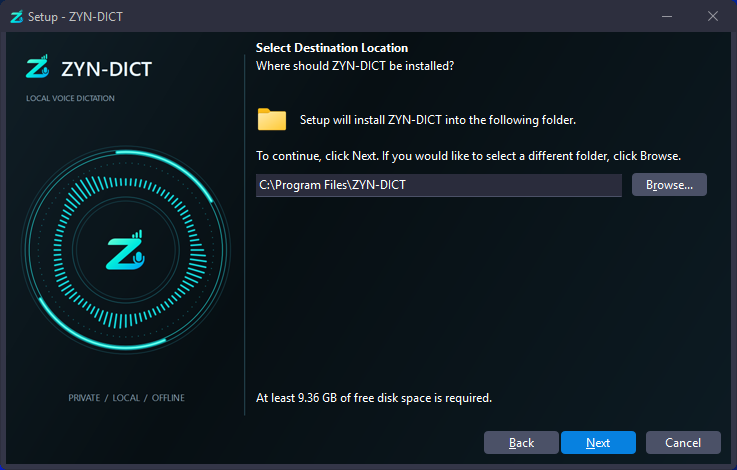
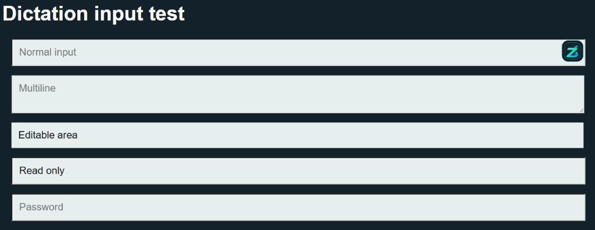
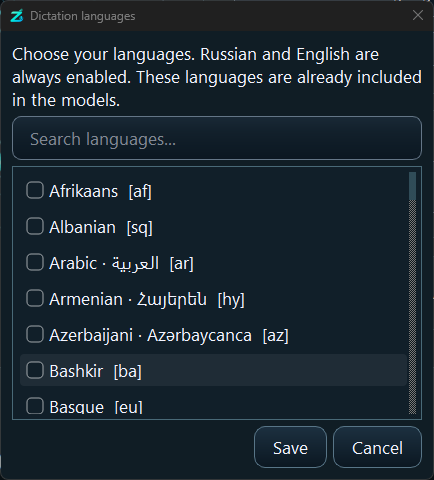

<p align="center">
  
</p>

<h1 align="center">ZYN-DICT</h1>

<p align="center"><b>Your voice. Your computer. Your text.</b></p>

<p align="center">
  Offline voice dictation for Windows — local Whisper recognition, local Qwen polish, no cloud API, no account, no per-token billing.
</p>

<p align="center">
  
  &nbsp;
  
  &nbsp;
  
  &nbsp;
  
</p>

<p align="center">
  <a href="https://t.me/zyntarvo"></a>
  &nbsp;
  <a href="https://www.youtube.com/@ZynTarvo"></a>
  &nbsp;
  <a href="https://zyntarvo.com"></a>
</p>

<p align="center"><b>Created by ZynTarvo</b> · <i>Nothing Is Impossible</i></p>

<p align="center">
  <a href="#install">Install</a> ·
  <a href="#how-it-works">How it works</a> ·
  <a href="#features">Features</a> ·
  <a href="#privacy">Privacy</a> ·
  <a href="README.ru.md">Русский</a>
</p>

---

<p align="center">
  
</p>

Hold **Ctrl+Alt** (or your own shortcut). Speak. Release.  
Text lands in the field you were typing in — Chat, Word, the browser, anywhere Windows can see an editable control.

Speech recognition and grammar polish run **on your machine**. Nothing is sent to a cloud AI.

## Why ZYN-DICT

| | |
|---|---|
| **100% local** | Whisper + Qwen stay on disk. No OpenAI / Google / Azure key. |
| **No per-token bill** | Dictate all day. There is no cloud meter. |
| **Models included** | The installer ships recognition + polish + a local recovery copy. No Hugging Face hunt. |
| **Two ways to talk** | Hold-to-talk hotkey, or a floating **Z** button next to the field. |
| **60 languages** | One multilingual model. Russian and English are on from the first launch. |
| **Works offline** | After you have the complete package, the internet can be unplugged. |

```
Choose a field  →  Hold / click Z  →  Speak  →  Release
      →  Recognize locally  →  Optional polish locally  →  Insert
```

## Install

Installer files sit in this repository, next to this README:

| File | Size |
|---|---:|
| [ZYN-DICT-Setup-1.0.0-x64.exe](ZYN-DICT-Setup-1.0.0-x64.exe) | 2.39 MB |
| [ZYN-DICT-Setup-1.0.0-x64-1.bin](ZYN-DICT-Setup-1.0.0-x64-1.bin) | 1.86 GiB |
| [ZYN-DICT-Setup-1.0.0-x64-2.bin](ZYN-DICT-Setup-1.0.0-x64-2.bin) | 1.86 GiB |
| [ZYN-DICT-Setup-1.0.0-x64-3.bin](ZYN-DICT-Setup-1.0.0-x64-3.bin) | 928 MB |

The `.exe` alone is **not** the full app. You need **all four files** in one folder, original names.

1. Download the four files from the list above (or **Code → Download ZIP**).
2. Optionally check [`SHA256SUMS.txt`](SHA256SUMS.txt).
3. Run the setup EXE. Default path: `C:\Program Files\ZYN-DICT` (or Browse to another drive).
4. Wait for splash: model check → restore if needed → engines ready.
5. Pick microphone, language, hotkey. Dictate.

**Needs ~9.4 GB** free for the installed app + working models + recovery copies.  
**OS:** Windows 10 1809+ or Windows 11, 64-bit. No separate .NET / Python / WebView2.

The installer is not code-signed yet — SmartScreen may warn on first run.

<p align="center">
  
</p>
<p align="center">
  
  &nbsp;
  
</p>

English steps: [`INSTALL.en.txt`](INSTALL.en.txt) · Russian: [`INSTALL.ru.txt`](INSTALL.ru.txt)

## How it works

### Hold-to-talk

<p align="center">
  
</p>

1. Click into the field.
2. Hold the shortcut and speak (default **Ctrl+Alt**; also Ctrl+Shift, F8, F9, F10).
3. Release to finish. Recognition + optional polish + insert.

Not live captions — the transcript appears after you stop talking. Max **2 minutes** per take. Escape cancels.

### Auto Detect by Mouse

Enable **Auto Detect by Mouse**. A floating **Z** appears beside compatible fields.

| Action | Result |
|---|---|
| Click **Z** | Start recording (no need to hold) |
| Click the **checkmark** | Finish, process, insert |
| Click **Z** again / **Escape** | Cancel |
| Right-drag **Z** | Park it away from the text |

Password, disabled and read-only fields are ignored. Detection uses Windows UI Automation — it does not read what you already typed.

<p align="center">
  
</p>

### Languages

Russian and English are always on. **Manage languages** unlocks a 60-language catalog (Azerbaijani, Turkish, Arabic, Chinese, Japanese, …) from the **same** bundled model — no extra download.

**Auto** detects the spoken language. If the detected language is not in your enabled list, the result is not auto-inserted.

Interface language (EN / RU flags) is independent of dictation language.

<p align="center">
  
</p>

### Local polish

**Polish grammar & punctuation** runs Qwen2.5-3B on `127.0.0.1` with a one-shot key. It is asked to fix grammar, punctuation, filler and obvious self-corrections — not to answer questions inside the dictation.

Safeguards fall back to the raw transcript if digits, length, negation or question-form look rewritten.

## Features

- Graphite Orbit UI — cyan rings, live FFT equalizer from the **same** mic capture
- Compact overlay: listening → recognizing → polishing, even if the main window is hidden
- Transparent startup splash (no opaque box)
- System tray; **Add to Auto Startup** (current-user Startup folder, off by default)
- Microphone picker + too-short / too-quiet / overflow handling
- Focus check before paste — will not dump text into a different window
- Does **not** press Enter. You send the message.
- Settings live in `<install>\data\settings.json` (kept across upgrade and uninstall)
- SHA-256 model integrity + restore from the bundled recovery payload

## Privacy

- No cloud transcription. No account. No telemetry of dictated text.
- Audio and the latest result stay in RAM. No recording archive, no transcript history.
- Local diagnostics (window ids, timings) — not the words you said.
- Clipboard is used for insert, then restored when the sequence has not changed. Windows clipboard history / cloud clipboard follow **your** OS settings.

## Stack

Whisper **large-v3-turbo** · faster-whisper / CTranslate2 · Qwen2.5-3B-Instruct Q4_K_M · llama.cpp Vulkan · PySide6 · Windows UI Automation · Inno Setup

CUDA is used when an NVIDIA GPU is present; recognition can fall back to CPU. Tested on Windows 11 + RTX 5050 8 GB. AMD/Intel GPU paths are not a certified matrix.

## Requirements & limits

- Windows 10 1809+ / 11, x64. Windows 7 is not supported.
- Working microphone with app permission.
- ~4.6 GiB download, ~9.4 GiB installed.
- Custom or inaccessible controls may not show the floating Z.
- Elevated (admin) apps can block insertion.
- Global hotkeys can clash with other software.
- Models make mistakes — check names and numbers before you send.

## License

The **application** is © ZynTarvo — see [`LICENSE`](LICENSE). It is **not** MIT / Apache.

Bundled **Qwen2.5-3B-Instruct** is under the [Qwen Research License](licenses/Qwen-Research-LICENSE.txt) (non-commercial research / evaluation unless you have a commercial grant from Alibaba Cloud). Whisper is MIT. Details: [`THIRD_PARTY_NOTICES.md`](THIRD_PARTY_NOTICES.md).

> Qwen is licensed under the Qwen RESEARCH LICENSE AGREEMENT, Copyright (c) Alibaba Cloud. All Rights Reserved.

## Support

Telegram [@zyntarvo](https://t.me/zyntarvo) · YouTube [@ZynTarvo](https://www.youtube.com/@ZynTarvo) · [zyntarvo.com](https://zyntarvo.com)

If ZYN-DICT saves you time and you want to say thank you, USDT on **Ethereum (ERC-20)**:

```
0xFd051b2267b75C9c2513Cb9BAd546e3C51d5dB44
```

<p align="center"><i>offline · speech-to-text · voice-dictation · whisper · local-llm · privacy · windows</i></p>
