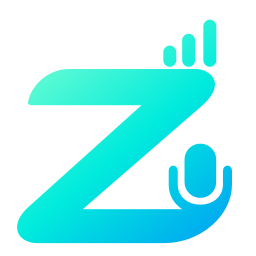
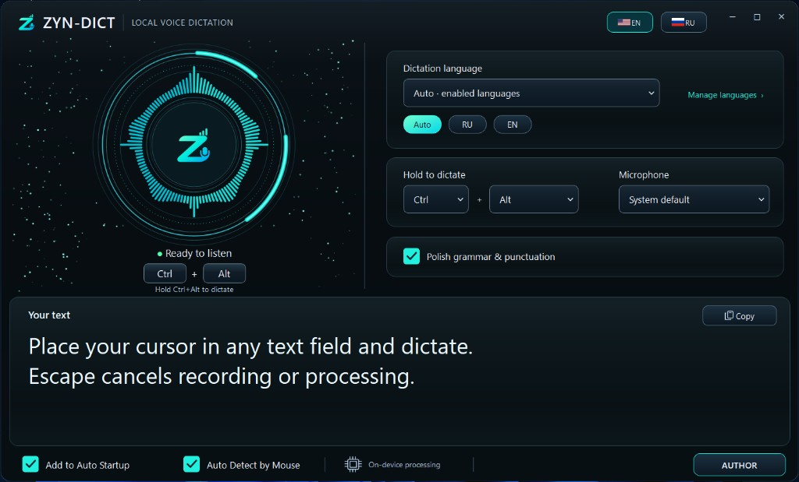

  

<h1 align="center">ZYN-DICT</h1>

<b>Твой голос. Твой компьютер. Твой текст.</b>

  Офлайн-диктовка для Windows. Whisper и Qwen работают локально — без облака, без аккаунта, без оплаты за токены.

<a href="README.md">English README</a> · <a href="https://drive.google.com/file/d/1zW7d_2Nxkb35j_-8pgrA1i3qsbd1WnJR/view?usp=drive_link">Скачать с Google Drive</a>

---

  

## Установка

Полный сетап — архив на **Google Drive**:

**https://drive.google.com/file/d/1zW7d_2Nxkb35j_-8pgrA1i3qsbd1WnJR/view?usp=drive_link**

Распакуй `ZYN-DICT-Setup.rar`. Внутри четыре файла в одной папке, имена не меняй:

| Файл | Размер |
|---|---:|
| `ZYN-DICT-Setup-1.0.0-x64.exe` | 2.39 МБ |
| `ZYN-DICT-Setup-1.0.0-x64-1.bin` | 1.86 ГиБ |
| `ZYN-DICT-Setup-1.0.0-x64-2.bin` | 1.86 ГиБ |
| `ZYN-DICT-Setup-1.0.0-x64-3.bin` | 928 МБ |

Один `.exe` без `.bin` — неполный пакет. ~9.4 ГБ свободно. Windows 10 1809+ / 11, x64.

Подробно: [`INSTALL.ru.txt`](INSTALL.ru.txt)

## Как говорить

1. Курсор в поле ввода.
2. Зажми **Ctrl+Alt** (или свою комбинацию) и говори. Отпусти — текст вставится.
3. Либо включи **Auto Detect by Mouse**: кнопка **Z** у поля, клик — запись, галочка — вставка, Escape — отмена.

Русский и английский включены сразу. Ещё ~60 языков — в **Manage languages**, без отдельной загрузки модели.

Галочка **Polish grammar & punctuation** прогоняет текст через локальный Qwen (грамматика, пунктуация, оговорки). При подозрительной переписке остаётся сырое распознавание.

Приложение **не** нажимает Enter. Отправку сообщения делаешь сам.

## Приватность

Аудио и текст не уходят в облако. Записи на диск не пишутся. Буфер обмена используется только для вставки.

## Лицензия

Приложение © ZynTarvo, см. [`LICENSE`](LICENSE). Модель Qwen2.5-3B — [Qwen Research License](licenses/Qwen-Research-LICENSE.txt) (некоммерческое исследование / оценка, пока нет отдельного гранта Alibaba Cloud).

Telegram [@zyntarvo](https://t.me/zyntarvo) · [zyntarvo.com](https://zyntarvo.com)
